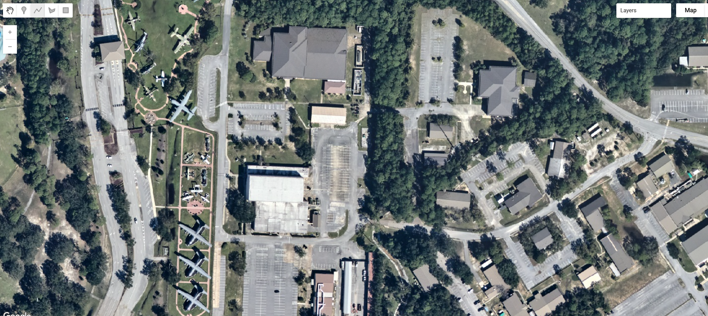

# Hurricane Isaias 2026 (NOAA Emergency Response Imagery)

Hurricane Isaias was the first hurricane and the first major hurricane of the 2026 Atlantic season. It formed as Tropical Depression Nine over the southwestern Gulf on 6 October 2026, strengthened to a hurricane early on 8 October, and peaked on 9 October as a Category 3 hurricane with maximum sustained winds of 120 mph (195 km/h) and a minimum pressure of 959 mb. It made landfall near Destin, Florida, at about 8:30 p.m. CDT that evening (01:30 UTC 10 October) as a Category 2 hurricane with 105 mph winds, became post-tropical over Alabama on 10 October and was last tracked northeast of Nashville on 11 October. The storm brought damaging winds, storm surge and flash flooding to the western Florida Panhandle and coastal Alabama, left more than 700,000 customers without power across Florida, Alabama and Georgia, and caused at least nine deaths. Between 10 and 13 October 2026 the NOAA National Geodetic Survey flew six aerial imaging missions over the Florida Panhandle, coastal Alabama and coastal Mississippi, and the resulting orthorectified RGB imagery, at roughly 15 to 30 cm ground sample distance, is catalogued here as a single Earth Engine collection.

#### Event Summary

??? example "This is being update constantly so please check online resources for latest"

    | Field | Value |
    |---|---|
    | Storm | Hurricane Isaias, NHC AL092026 (not the 2020 storm of the same name) |
    | Formation | Tropical Depression Nine, 21:00 UTC 6 October 2026, 22.1N 95.6W, southwestern Gulf; named Tropical Storm Isaias at 09:00 UTC 7 October |
    | Peak intensity | Category 3, 120 mph (195 km/h), 959 mb, 9 October 2026, near 27.0N 87.6W |
    | Landfall | Near Destin, Florida, about 8:30 p.m. CDT 9 October (01:30 UTC 10 October), Category 2, 105 mph, about 971 mb |
    | End | Post-tropical over Alabama by 09:00 UTC 10 October; final advisory 15:00 UTC 11 October near 37.5N 84.0W |
    | Areas affected | Florida Panhandle (Santa Rosa and Escambia counties worst hit), coastal Alabama and Mississippi, Georgia; inland rain and tornadoes into the Carolinas and Tennessee; precursor rain in Tamaulipas and Veracruz, Mexico |
    | Deaths | At least 9 (Florida 6, Alabama 2, South Carolina 1); provisional |
    | Peak wind gusts | 118 mph at Jay, 116 mph at Oriole Beach, 114 mph at Whiting Field, Florida (NWS Mobile) |
    | Storm surge | 5.6 ft above MHHW at Panama City Beach; 3.98 ft at Old Pass Lagoon and 3.68 ft at East Pass, Destin |
    | Rainfall | 11.65 in near Mary Esther, Florida (NWS Mobile) |
    | Power outages | About 700,000 customers across Florida, Alabama and Georgia at peak |
    | Insured losses | Estimates range from US$1 to 2 billion (Verisk) to US$3 billion (KCC) and US$2.5 to 4.5 billion (Moody's RMS) |
    | Response | FEMA emergency declarations EM-3655 (Florida), EM-3656 (Alabama) and EM-3657 (Georgia), 9 October; Florida requested a major disaster declaration on 16 October |
    | Imagery | NOAA NGS Emergency Response Imagery, six flights, 10 to 13 October 2026 |

NHC has not yet published its Tropical Cyclone Report for Isaias, so every intensity and impact figure here is preliminary. Insured loss estimates from different modellers still differ by a factor of two or more. Check the sources below before citing a number.



#### NOAA Emergency Response Imagery

The NOAA National Geodetic Survey's Remote Sensing Division flies aerial imaging missions after major storms to support emergency response, navigation safety and coastal damage assessment. For Isaias, six flights between 10 and 13 October covered the coast from Mississippi to Cape San Blas, Florida. The imagery comes from NOAA's Digital Sensor System (DSS) version 6, a pair of RGB frame cameras tilted roughly 22 degrees either side of the flight line. Each frame is 14,204 by 10,652 pixels. Frames are orthorectified using Applanix POS AV GNSS/INS data over the USGS National Elevation Dataset. They are then mosaicked and cut into tiles 45 arc-seconds (0.0125 degrees) on a side. The collection holds 5,599 tiles. NOAA also publishes a 5 m overview of each whole flight beside the tiles; these are not part of the collection.

| Flight | Captured (UTC) | Tiles | Approximate area | Coverage |
|---|---|---|---|---|
| `20261010a` | 10 Oct, 20:31 to 20:51 | 54 | 50 km² | Cape San Blas and Port St. Joe, Gulf County, Florida (flown low, at about 800 m) |
| `20261011a` | 11 Oct, 14:40 to 18:15 | 1,621 | 2,200 km² | Coast from Fort Morgan and Gulf Shores, Alabama, east through Pensacola Beach, Navarre, Destin and Panama City Beach to Tyndall AFB |
| `20261011b` | 11 Oct, 21:42 to 22:52 | 627 | 925 km² | Pensacola, Gulf Breeze, and Milton and Pace in Santa Rosa County |
| `20261012a` | 12 Oct, 13:09 to 16:44 | 1,745 | 2,300 km² | Mobile Bay (Mobile, Daphne, Fairhope), Dauphin Island and the barrier islands |
| `20261012b` | 12 Oct, 19:19 to 21:49 | 1,200 | 1,500 km² | Mississippi coast from Pascagoula to Waveland, and Bayou La Batre, Alabama |
| `20261013a` | 13 Oct, 15:28 to 16:05 | 352 | 455 km² | Tyndall AFB, Mexico Beach, Port St. Joe and Cape San Blas |

Except for the first flight, the aircraft flew at about 2,300 m (7,500 ft), giving a native ground sample distance near 0.2 m. The tiles are stored in EPSG:4326 at 2.248e-6 degrees, about 0.22 m east to west and 0.25 m north to south at this latitude. Flight `20261010a` was flown at about 800 m, and its tiles are sharper, roughly 0.13 to 0.15 m.

```js
// NOAA Emergency Response Imagery, Hurricane Isaias, six flights 10 to 13 October 2026.
var isaias = ee.ImageCollection("projects/sat-io/open-datasets/NOAA-EMERGENCY-RESPONSE/HURRICANE_ISAIAS_2026");
```

#### Bands and properties

Each image is a single 8-bit tile with three bands, `red`, `green` and `blue`. NOAA's alpha channel is not a separate band. It is applied as the image mask, so areas outside the flight's coverage are transparent rather than black. Each tile's ID names its flight and its north-west corner: `noaa-eri__2026_Hurricane_Isaias__20261012a_RGB__20261012aC0865315w303515n_image` is flight `20261012a`, with a corner at 86°53′15″W, 30°35′15″N.

| Property | Description |
|---|---|
| `stac_id` | Tile ID including the flight, for example `..._20261012a_RGB__20261012aC0865315w303515n` |
| `acquired` | The flight date. NOAA publishes no time of day per tile, so this is set to 12:00 UTC on the day of the flight. Use the table above for actual capture windows |
| `gsd` | Pixel size in metres, east to west |
| `aftermap_event_name`, `aftermap_event_start`, `aftermap_disaster_type` | Event context |

To select a single flight, filter on the flight ID inside `stac_id`:

```js
var flight = isaias.filter(ee.Filter.stringContains('stac_id', '20261012a_RGB'));
```

#### Visualization

The tiles are 8-bit RGB and can be shown directly. Adding the collection to the map draws its mosaic, so neighbouring tiles join without seams:

```js
var vis = {bands: ['red', 'green', 'blue'], min: 4, max: 240};
Map.setCenter(-87.15, 30.37, 15); // Pensacola Beach
Map.addLayer(isaias, vis, 'Hurricane Isaias, NOAA ERI');
```

Much of the imagery is hazy, and the three bands sit in different parts of the 0 to 255 range. Over forest the 2nd to 98th percentiles were about red 36 to 116, green 62 to 128 and blue 83 to 130. A per-band stretch on those values adds contrast and removes the blue cast over vegetation and water, but it saturates bright surfaces such as roofs, sand, concrete and industrial sites:

```js
Map.addLayer(isaias, {bands: ['red', 'green', 'blue'], min: [36, 62, 83], max: [116, 128, 130], gamma: 1.1}, 'Isaias, per-band stretch');
```

Sample code: https://code.earthengine.google.com/?scriptPath=users/sat-io/awesome-gee-catalog-examples:disaster-response/NOAA-ERI-HURRICANE-ISAIAS-2026

Things to know before analysing this imagery:

**Times are per flight, not per tile.** Tiles carry no time of day. Flights `a` and `b` on the same date were flown hours apart, under different sun angles, so their brightness and shadows differ.

**This is post-event imagery only.** NOAA flies after the storm. There is no matching pre-event aerial coverage in this collection.

**Positional accuracy has not been assessed.** NOAA expects horizontal positions to be within 3 to 5 m but has not verified this. The imagery is not intended for mapping, charting, navigation or use in litigation.

**Cloud is possible.** The aircraft flies below most cloud, but low cloud and its shadow can appear in some frames. The collection has no cloud mask.

#### License

NOAA Emergency Response Imagery is in the public domain in the United States, and NOAA waives its rights worldwide under CC0 1.0. NOAA asks that users credit NOAA as the source and disclose any modifications.

Data provided by: NOAA National Geodetic Survey, Remote Sensing Division

Curated in GEE by: Samapriya Roy

Keywords: disaster, hurricane, tropical cyclone, storm surge, aerial imagery, NOAA, NGS, emergency response imagery, Isaias, Florida, Alabama, Mississippi, Pensacola, Destin, Mobile Bay, Gulf Coast

Last updated on GEE: 2026-10-23
