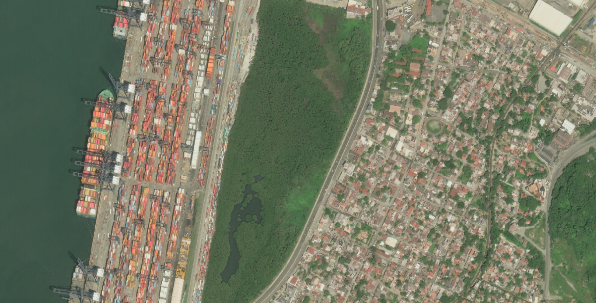

# Hurricane Simon 2026 (Mexico)

Hurricane Simon was a Category 4 tropical cyclone of the 2026 eastern North Pacific hurricane season. It formed as Tropical Depression Twenty-E on 7 October 2026 about 285 mi south-southeast of Lázaro Cárdenas, became a tropical storm the same day, and then tracked slowly north-northwest parallel to Mexico's southwestern coast. Simon peaked on 11 October with maximum sustained winds of 155 mph (250 km/h) and a central pressure of 928 mb. Its eye was then roughly 50 km offshore between Manzanillo and Puerto Vallarta, and its inner core brushed the coast. The storm never made landfall. It weakened over the following days and dissipated about 100 mi southwest of Cabo San Lucas on 16 October. Its outer bands brought heavy rain, flash flooding and landslides from Guerrero to Jalisco, flooded Manzanillo, closed the Manzanillo and Puerto Vallarta airports, and cut power to about 65,000 customers in Guerrero. At least one death has been directly attributed to the storm. Vantor's (formerly Maxar) Open Data Program released very high resolution post-event imagery of Puerto Vallarta, Manzanillo and Lázaro Cárdenas, catalogued here as an Earth Engine collection.

#### Event Summary

??? example "This is being update constantly so please check online resources for latest"

    | Field | Value |
    |---|---|
    | Storm | Hurricane Simon, NHC EP202026 (not the 2014 storm of the same name) |
    | Formation | Tropical Depression Twenty-E, 15:00 UTC 7 October 2026, 14.1N 100.9W; Tropical Storm Simon at 21:00 UTC the same day |
    | Peak intensity | Category 4, 155 mph (250 km/h), 928 mb, 03:00 UTC 11 October 2026, about 65 mi southwest of Manzanillo |
    | Landfall | None. Closest approach on 11 October, eye about 50 km off the coast between Manzanillo and Puerto Vallarta |
    | Dissipation | 21:00 UTC 16 October 2026, near 21.5N 110.3W, about 100 mi southwest of Cabo San Lucas |
    | States affected | Guerrero, Michoacán, Colima, Jalisco, Nayarit and Sinaloa; high surf in Baja California Sur |
    | Deaths | At least 1 directly attributed to Simon (Chilpancingo, Guerrero). Higher totals reported for the same days include deaths in Baja California from the remnants of Tropical Storm Rachel |
    | Rainfall | About 135 mm in under two hours in Acapulco on 8 October (Acapulco Civil Protection) |
    | Power outages | 65,078 CFE customers in Guerrero, fully restored by 10 October |
    | Damage | 71 homes and 35 businesses affected in Colima; Colima–Manzanillo highway blocked by an overflowing stream on 11 October; damage described by the federal government as minor |
    | Alerts | GDACS Orange alert, tropical cyclone SIMON-26 (event 1001335) |
    | Imagery | Vantor Open Data, post-event, 10 to 21 October 2026 |

NHC has not yet published its Tropical Cyclone Report for Simon, so the intensity figures are provisional. Death tolls reported in the days after the storm often combine Simon with Tropical Storm Rachel, which struck Baja California at the same time. No International Charter or Copernicus EMS activation was found for this event.



#### Vantor (Maxar) Open Data

Vantor published the event as `Mexico-Hurricane-Simon-Oct-2026` under CC BY-NC 4.0, with the first scenes released on 10 October 2026. All imagery is post-event, at panchromatic resolutions of about 0.32 to 0.82 m, from WorldView Legion, WorldView-2, WorldView-3 and GeoEye-1. Coverage is concentrated on three areas:

| Area | State | Scenes (approx.) |
|---|---|---|
| Puerto Vallarta and Bahía de Banderas, including a coastal strip near Cabo Corrientes | Jalisco and Nayarit | 16 |
| Manzanillo | Colima | 7 |
| Lázaro Cárdenas | Michoacán | 5 |

Vantor labels every scene in this event as post-event. Three Puerto Vallarta scenes from 10 October were taken before Simon's closest approach on 11 and 12 October, so they are better read as near-event than as post-event imagery. The collection contains 28 scenes acquired between 10 and 21 October. A further WorldView-2 scene of Puerto Vallarta from 22 October will be added.

```js
// Vantor (Maxar) open data, post-event imagery of Hurricane Simon.
var vantorSimon2026 = ee.ImageCollection("projects/sat-io/open-datasets/VANTOR-DISASTER-DATA/HURRICANE_SIMON_2026");
```

#### Preprocessing

Vantor's open data imagery ships without a cloud mask of any kind. Every scene in this collection was therefore passed through OmniCloudMask during ingestion, and two derived bands were added after the imagery bands:

| Band | Type | Values |
|---|---|---|
| `red`, `green`, `blue` | 8-bit visual imagery | 0 to 255; pixels where all three are 0 are no data |
| `cloud_mask` | Binary | 0 = not cloud, 1 = solid cloud |
| `cloud_probability` | Continuous | 0 to 100 percent |

OmniCloudMask is a sensor-agnostic deep learning model for cloud and cloud shadow segmentation. Vantor imagery has no near-infrared band, so blue is passed in its place. Comparisons on PlanetScope imagery found this costs nothing measurable. The model is trained for 10 to 50 m imagery, so scenes are resampled to 10 m for inference and the mask is resampled back onto the native grid. Only solid cloud counts as cloud in `cloud_mask`, because thin cloud and haze are the model's least reliable classes. Pixels deep inside large, bright, saturated clouds are sometimes classed as clear, so check the imagery before relying on the mask over heavy cloud.

```
Wright, N., Duncan, J.M.A., Callow, J.N., Thompson, S.E., & George, R.J. (2025). Training sensor-agnostic deep learning models for remote sensing: Achieving state-of-the-art cloud and cloud shadow identification with OmniCloudMask. Remote Sensing of Environment, 322, 114694. https://doi.org/10.1016/j.rse.2025.114694
```

Masking no data, and cloud with the threshold passed in as a percentage:

```js
// No data is black fill: every visual band is 0.
function maskNoData(image) {
  var rgb = image.select(['red', 'green', 'blue']);
  // copyProperties returns an Element, so cast back to an Image.
  return ee.Image(rgb
    .updateMask(rgb.reduce(ee.Reducer.max()).gt(0))
    .copyProperties(image, image.propertyNames()));
}

// Cloud mask, threshold passed in as a percentage.
function maskClouds(maxCloudPct) {
  return function (image) {
    var clear = image.select('cloud_probability').lte(maxCloudPct);
    return maskNoData(image).updateMask(clear);
  };
}

var noData = vantorSimon2026.map(maskNoData);
var masked = vantorSimon2026.map(maskClouds(30));

Map.setCenter(-104.32, 19.08, 13); // Manzanillo
Map.addLayer(noData.mosaic(), {min: 0, max: 255}, 'No-data masked only');
Map.addLayer(masked.mosaic(), {min: 0, max: 255}, 'No-data + cloud masked');
```

Scene-level cloud cover as reported by Vantor ranges from 0 to 74 percent and is stored as `cloud_percent`. Other useful properties are `acquired`, `view_angle`, `sun_elevation` and `sun_azimuth`. To pick the clearest scenes over one area, filter on bounds and sort by Vantor's cloud figure:

```js
var puertoVallarta = ee.Geometry.Point([-105.23, 20.62]);
var clearest = vantorSimon2026
  .filterBounds(puertoVallarta)
  .sort('cloud_percent', false) // mosaic() draws the last image on top
  .map(maskNoData);
Map.addLayer(clearest.mosaic(), {min: 0, max: 255}, 'Puerto Vallarta, clearest first', false);
```

Sample code: https://code.earthengine.google.com/?scriptPath=users/sat-io/awesome-gee-catalog-examples:disaster-response/VANTOR-OPEN-DATA-HURRICANE-SIMON-2026

#### License

The collection on this page is released under Creative Commons Attribution Non Commercial 4.0.

Data provided by: Vantor (Maxar) Open Data Program

Curated in GEE by: Samapriya Roy

Keywords: disaster, hurricane, tropical cyclone, eastern Pacific, Mexico, Jalisco, Colima, Michoacán, Guerrero, Puerto Vallarta, Manzanillo, Lázaro Cárdenas, Vantor, Maxar, WorldView Legion, WorldView, GeoEye

Last updated on GEE: 2026-10-22
