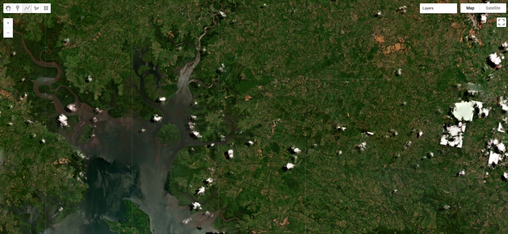

# Panama Earthquake (Azuero Peninsula) 2026

On 9 October 2026 at 17:56 UTC (12:56 local time), a magnitude 7.7 (Mww, USGS) earthquake struck the Azuero Peninsula of central Panama at a shallow depth of about 13 km, roughly 40 km northwest of Tonosí. It was the largest earthquake in Panama since 1882. USGS describes the mechanism as left-lateral strike-slip faulting within the Panama microplate, the block caught between the Cocos and Nazca plates to the south and the Caribbean plate to the north. Some reports attribute the rupture to the west-northwest-trending Azuero–Soná fault, though USGS has not named a fault. A vigorous aftershock sequence followed, including an M6.6 shock that afternoon and 19 aftershocks of M5 or larger by 12 October. Shaking damaged more than 10,000 homes, along with hundreds of schools and health facilities. It also triggered more than 2,000 landslides across Los Santos, Herrera, Veraguas and Coclé, cutting off rural communities. Copernicus EMS (EMSR934) and the International Charter (activation 1054) were both activated. Through its Crisis Response Program, Planet Labs released post-event Pelican, PlanetScope and SkySat imagery acquired 11 to 15 October, together with a pre-event Q3 2026 basemap, and all of it is catalogued here as one Earth Engine collection.

#### Event Summary

??? example "This is being update constantly so please check online resources for latest"

    | Field | Value |
    |---|---|
    | Date / time | 9 October 2026, 17:56:06 UTC (12:56:06 local, UTC−5) |
    | USGS event | us6000u18k, "12 km WSW of Pitaloza Arriba, Panama" |
    | Magnitude | Mww 7.7 (USGS, reviewed). Early USGS and PTWC solutions, and Planet's catalogue, give 7.6; Panama's Instituto de Geociencias (IGC-UP) gives 7.5 |
    | Epicentre / depth | 7.587°N, 80.769°W; 12.6 km (USGS). IGC-UP gives 4 km |
    | Mechanism | Left-lateral strike-slip (USGS moment tensor; finite fault Mw 7.66, strike 295°, dip 60°) |
    | Shaking | USGS ShakeMap maximum about MMI VIII; about 3.4 million people exposed to moderate to severe shaking |
    | PAGER | Orange overall (economic losses orange, fatalities yellow) |
    | Largest aftershock | M6.6 at 20:25 UTC on 9 October, 12 km west of Río Grande (USGS). Colombia's SGC reported the same shock as M6.9 |
    | Provinces affected | Los Santos, Herrera, Veraguas and Coclé, with damage also reported in Chiriquí and the Ngäbe-Buglé comarca |
    | Deaths | 2 confirmed by the Ministry of Health as of 22 October (Macaracas and Santiago de Veraguas) |
    | Injuries | 27 (SINAPROC, 20 October) |
    | Housing | 10,655 homes assessed by 20 October; 1,952 totally destroyed as of 17 October; 74 percent of assessed homes in Los Santos and Herrera |
    | People affected | 35,065, with 5,628 in 126 shelters (SINAPROC, 20 October) |
    | Public buildings | 619 schools and 120 health facilities affected (20 October) |
    | Landslides | At least 2,351, a preliminary IGC-UP count from cloud-limited Sentinel-2 imagery |
    | Tsunami | Warning issued by PTWC at about 18:02 UTC for the Pacific coasts of Central America, Colombia and Ecuador; cancelled at about 19:40 UTC; about 300 people evacuated from Isla Cañas |
    | Response | National state of emergency 10 October, up to US$100 million authorised; Copernicus EMS EMSR934 (9 areas of interest); International Charter activation 1054 (11 October) |

The housing and casualty figures were still rising when this page was written. SINAPROC (Panama's civil protection agency) issues numbered damage reports, and each one supersedes the last. Check the sources below before citing a number.



#### Planet Labs Disaster Data

Planet's Crisis Response Program published a STAC catalog for the event on Source Cooperative, structured as 109 items across five collections. The pre-event baseline is the PlanetScope Q3 2026 quarterly basemap. Post-event coverage comes from three sensors, with collections keyed by sensor and acquisition date so that resolutions never mix within one collection.

| Collection | Phase | Sensor | Items | Acquired (UTC) | GSD | Multiband product | Mask |
|---|---|---|---|---|---|---|---|
| `pre-event-basemap-2026q3` | Pre-event | PlanetScope quarterly basemap | 80 quads | Composite, July to September 2026 | approximately 4.8 m (Web Mercator) | None (visual only) | None |
| `post-event-pelican-2026-10-11` | Post-event | Pelican (`300b`, `300e`) | 2 | 2026-10-11 15:55 to 16:05 | approximately 0.57 to 0.62 m | Pansharpened, 6 bands | `udm2` |
| `post-event-planetscope-2026-10-11` | Post-event | PlanetScope SuperDove (`255a`) | 4 | 2026-10-11 15:52 | approximately 3.8 m | Analytic, 4 bands (TOA radiance) | `udm2` |
| `post-event-skysat-2026-10-14` | Post-event | SkySat (`SSC4`) | 8 | 2026-10-14 12:19 | approximately 0.63 to 0.70 m | Pansharpened, 4 bands | `udm2` |
| `post-event-skysat-2026-10-15` | Post-event | SkySat (`SSC7`, `SSC8`) | 15 | 2026-10-15 20:21 to 20:24 | approximately 0.72 to 0.84 m | Pansharpened, 4 bands | `udm2` |

The post-event collections cover different parts of the peninsula and barely overlap. Pelican covers a strip from Santiago de Veraguas east to Chitré. PlanetScope covers Santiago de Veraguas and the country north of it. The 14 October SkySat strips cover the Soná area in western Veraguas, and the 15 October strips cover Tonosí and the southern Azuero near the epicentre. The basemap spans all of them, from about 81.9°W to 79.8°W.

Each post-event scene is ingested twice: once as its 8-bit `visual` product and once as its multiband product. Both carry the UDM2 bands. In Earth Engine the collection therefore holds 138 images: 80 basemap quads, 29 visual scenes and 29 multiband scenes. The `bundle` property tells them apart.

```js
// Planet Labs disaster data, pre-event Q3 2026 basemap plus post-event Pelican, PlanetScope and SkySat.
var planetPanamaEq2026 = ee.ImageCollection("projects/sat-io/open-datasets/PLANET-DISASTER-DATA/PANAMA_EQ_2026");
```

#### Bands and properties

| `bundle` | Images | Bands |
|---|---|---|
| `visual` | 80 basemap quads | `red`, `green`, `blue` (8-bit) |
| `visual_udm2` | 29 scenes | `red`, `green`, `blue` (8-bit), then the UDM2 bands |
| `analytic_udm2` | 4 PlanetScope scenes | `blue`, `green`, `red`, `nir` (16-bit radiance), then the UDM2 bands |
| `pansharpened_udm2` | 23 SkySat scenes | `blue`, `green`, `red`, `nir` (16-bit), then the UDM2 bands |
| `pansharpened_udm2` | 2 Pelican scenes | `b1` to `b6` (16-bit), then the UDM2 bands |

The Pelican pansharpened bands are not named in Planet's STAC. The band descriptions embedded in the GeoTIFFs give their order as blue, green, red, NIR, red edge and narrow NIR, so `b1` is blue and `b3` is red.

The UDM2 bands are `clear`, `snow`, `shadow`, `haze_light`, `haze_heavy` and `cloud` (each 0 or 1), `confidence` (0 to 100) and `udm1`, the legacy unusable-data mask.

Useful properties are `bundle`, `provider` (`planetscope`, `skysat` or `pelican`), `item_type`, `satellite_id`, `acquired`, `gsd`, `cloud_percent`, `view_angle`, `sun_elevation` and, for the basemap, `mosaic` and `quad_id`.

```js
// Keep only pixels UDM2 calls clear.
function maskUdm2(image) {
  return image.updateMask(image.select('clear').eq(1));
}

var basemap = planetPanamaEq2026.filter(ee.Filter.eq('bundle', 'visual'));
var postVisual = planetPanamaEq2026.filter(ee.Filter.eq('bundle', 'visual_udm2')).map(maskUdm2);
var skysat = postVisual.filter(ee.Filter.eq('provider', 'skysat'));
var pelican = postVisual.filter(ee.Filter.eq('provider', 'pelican'));

Map.setCenter(-80.44, 7.40, 14); // Tonosí, near the epicentre (SkySat, 15 Oct)
Map.addLayer(basemap.mosaic(), {bands: ['red', 'green', 'blue'], min: 0, max: 255}, 'Pre-event basemap, 2026 Q3');
Map.addLayer(skysat.mosaic(), {bands: ['red', 'green', 'blue'], min: 0, max: 255}, 'SkySat, 14 to 15 Oct');
Map.addLayer(pelican.mosaic(), {bands: ['red', 'green', 'blue'], min: 0, max: 255}, 'Pelican, 11 Oct (Chitré to Santiago)');
```

Vegetation loss is one of the clearest signals of landslides. NDVI from the SkySat multiband product, masked to clear pixels:

```js
var ndvi = planetPanamaEq2026
  .filter(ee.Filter.eq('bundle', 'pansharpened_udm2'))
  .filter(ee.Filter.eq('provider', 'skysat'))
  .map(maskUdm2)
  .map(function (image) {
    return image.normalizedDifference(['nir', 'red']).rename('ndvi');
  })
  .mosaic();
Map.addLayer(ndvi, {min: -0.2, max: 0.9, palette: ['8c510a', 'f6e8c3', '01665e']}, 'SkySat NDVI', false);
```

Sample code: https://code.earthengine.google.com/?scriptPath=users/sat-io/awesome-gee-catalog-examples:disaster-response/PLANET-OPEN-DATA-PANAMA-EARTHQUAKE-2026

Four things in Planet's release notes, and in the data itself, are worth knowing before building an analysis on this collection:

**The baseline is a seasonal composite, not a before-image.** The Q3 2026 basemap blends PlanetScope scenes from July to September into a cloud-free mosaic, so it shows the landscape in the months before the earthquake rather than on any single day. It is also in Web Mercator at about 4.8 m, while the scenes are in UTM at 0.5 to 3 m. Reproject to a common grid before comparing pixel by pixel.

**The 15 October SkySat strips are the cloudiest in the catalogue.** Planet's README puts them at 37 to 58 percent clear per strip. Mask with UDM2 before mapping damage. The per-scene `cloud_percent` values imply more clear ground than the README does, possibly because the README also excludes shadow and haze.

**Processing levels differ.** PlanetScope `analytic` is top-of-atmosphere radiance, and SkySat and Pelican `pansharpened` are scaled digital numbers. The `visual` products are the only ones directly comparable across all three sensors.

**Resolution spans nearly 8x** (0.5 m Pelican and SkySat to 3.8 m PlanetScope and 4.8 m basemap). Read `gsd` per image rather than assuming a uniform pixel size.

#### License

The collection on this page is released under Creative Commons Attribution Non Commercial 4.0.

Data provided by: Planet Labs PBC Disaster Data

Curated in GEE by: Samapriya Roy

Keywords: disaster, earthquake, landslide, Panama, Azuero, Los Santos, Herrera, Veraguas, Coclé, Tonosí, Chitré, Santiago de Veraguas, Soná, Planet Labs, PlanetScope, SkySat, Pelican

Last updated on GEE: 2026-10-23
